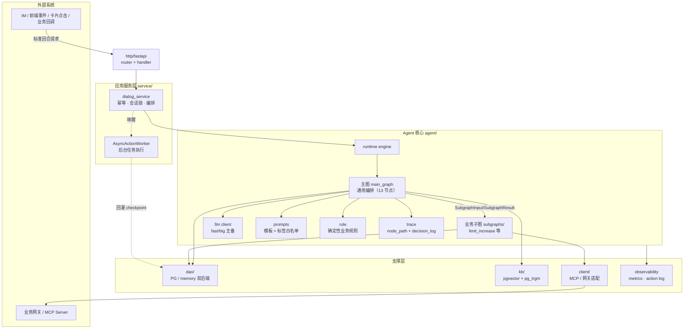
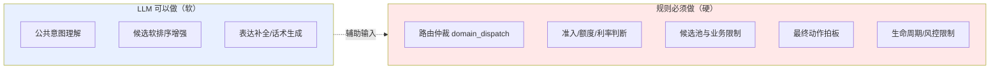
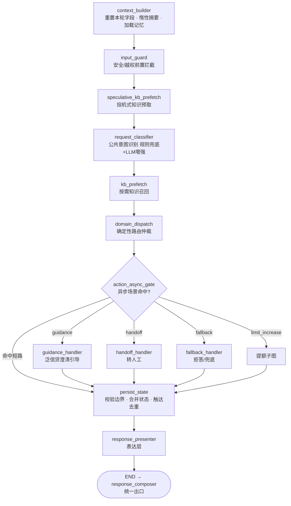
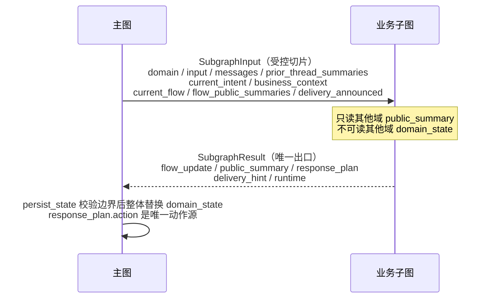
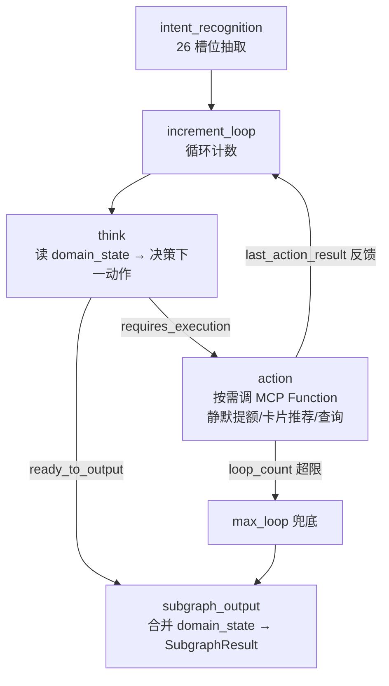
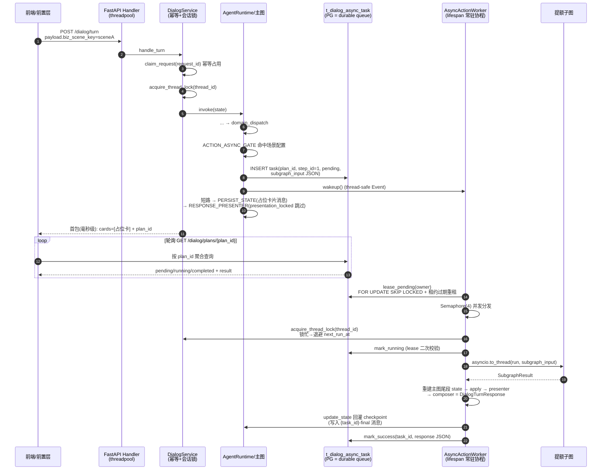

# rc-credit-agent 架构设计剖析

> **用途**：项目面试讲解材料 · 一文读懂信贷业务智能体的架构设计、核心设计点、与主流 Agent 架构的对比
>
> **项目定位**：信贷业务 Agent Runtime（信贷机器人 Python 侧核心），面向信贷咨询、提额/降息、进度查询、结果承接等场景

---

## 目录

1. [项目一页概览](#一项目一页概览)
2. [整体分层架构](#二整体分层架构)
3. [核心设计哲学：规则优先、LLM 辅助](#三核心设计哲学规则优先llm-辅助)
4. [主图设计（编排层）](#四主图设计编排层)
5. [业务子图设计（以提额为例）](#五业务子图设计以提额为例)
6. [记忆体系](#六记忆体系)
7. [异步任务架构（先回卡片 + 后台执行 + 轮询）](#七异步任务架构)
8. [工程保障体系：幂等、容错、可观测](#八工程保障体系)
9. [与主流 Agent 架构的对比分析](#九与主流-agent-架构的对比分析)
10. [面试讲解要点清单](#十面试讲解要点清单)

---

## 一、项目一页概览

| 维度 | 内容 |
|---|---|
| **业务场景** | 信贷咨询、提额/降息、进度查询、结果承接、引导办理 |
| **技术栈** | FastAPI + LangGraph + Pydantic + PostgreSQL（pgvector/pg_trgm）/ memory 双后端 |
| **LLM 接入** | OpenAI-compatible 协议，fast / big 两档模型，每档主备自动降级 |
| **对外协议** | 统一入口 `POST /dialog/turn`，`DialogTurnRequest → DialogTurnResponse` |
| **动作终态** | 仅三类：`reply`（回复）/ `handoff`（转人工）/ `silent`（无回复） |
| **测试评测** | pytest（代码正确性）+ promptfoo（业务口径与安全合规）双轨 |
| **代码规模** | 180 个 Python 源文件，schema/contract 贯穿全链路，禁止 dict 透传 |

**一句话概括**：前置层做适配，主图做编排，子图做领域决策，client/dao 收敛外部能力和存储，`response_composer` 统一出口。

**三条铁律**：

1. 不破坏 `/dialog/turn` 标准协议；
2. 不绕过 `schema/` 透传临时 dict；
3. **不让 LLM 决定业务硬规则**（准入、额度、路由、候选池、最终动作全部由确定性规则决定）。

---

## 二、整体分层架构



**分层职责边界**：

| 层 | 职责 | 明确不做 |
|---|---|---|
| `http/` 接入层 | 参数校验、响应转换 | 不写业务判断、不直接调 graph node |
| `service/` | 请求组装、request_id 幂等、thread 串行锁、超时 | 不沉淀业务规则、不感知节点细节 |
| `agent/` 编排层 | 主图通用编排 + 子图领域闭环 | 主图不做领域决策；LLM 不做硬规则 |
| `client/` | MCP/网关封装、contract 收敛、错误映射 | 私有协议不向上层扩散 |
| `dao/` | 持久化适配（memory/PG 一个开关切换） | 上层不写裸 SQL |

---

## 三、核心设计哲学：规则优先、LLM 辅助

这是整个项目最高层的设计决策，也是面试中最值得展开的一点。



**为什么这样设计（金融场景的本质要求）**：

- **可审计**：每一笔准入、路由、动作都有确定性代码路径，监管可回溯；
- **抗幻觉**：LLM 的输出只影响"理解和表达"，不进入决策链，从源头掐断一本正经胡说带来的资损风险；
- **可灰度**：硬规则配置化（Hippo 配置中心 + JSON 兜底），可以逐场景放量，LLM 层变更不影响业务正确性；
- **外部 `target_domain` 也无权决定路由**——防止上游系统或 Prompt 注入直接劫持业务流向。

> **面试话术**："我们把 Agent 拆成决策层和表达层。决策层是确定性规则引擎，LLM 只在决策层外围做意图理解和表达补全。这本质上是对'LLM 幻觉'的系统性工程防御——不是让模型更靠谱，而是让模型的不可靠性根本影响不到业务结果。"

---

## 四、主图设计（编排层）

### 4.1 节点拓扑（实测源码）



### 4.2 路由优先级（确定性仲裁，LLM 不参与二次拍板）

```text
预置 domain_route(input_guard)
  > input_guard 预置拒答结果兜底
  > event(delivery 匹配)
  > event(NLU)
  > nlu_intent
  > fallback
```

### 4.3 状态模型 AgentState（分层容器，非平铺 dict）

```python
class AgentState(BaseModel):
    session: SessionState          # 用户/会话标识 + 跨 thread 摘要（跨轮恢复）
    messages: list[BaseMessage]    # 当前 thread 全量消息（add_messages 合并）
    input: InputEventState         # 本轮输入事件（每轮覆盖）
    current_intent: BusinessIntent | None   # 公共意图（每轮重置）
    domain_route: DomainRoute | None        # 路由结果（每轮重置）
    business_context: BusinessContextState # 用户画像（跨轮恢复）
    current_domain: BusinessDomainLabel | None  # 当前业务焦点
    flows: dict[str, FlowState]    # {domain: FlowState}，仅真实业务域
    subgraph_result: SubgraphResult | None  # 本轮子图结果（每轮重置）
    delivery: DeliveryState        # 触达去重状态（跨轮恢复）
    runtime: RuntimeState          # trace_id/node_path/decision_log（每轮重置）
```

**生命周期设计要点**（面试高频）：

- 本轮临时字段（`current_intent/domain_route/subgraph_result/runtime`）**每轮强制重置**，`context_builder` 是第一道闸；
- `trace_id` **只从本轮 payload 提取**，不跨请求继承，防止链路串链；
- `guidance/fallback` 不维护 `FlowState`——只有真实业务域才有私有状态。

### 4.4 主图-子图受控协议



**边界校验规则**：`guidance/fallback` 不许返回 `flow_update/public_summary`；业务子图返回的 `domain` 必须与路由目标一致；子图不能读其他域私有 `domain_state`。

---

## 五、业务子图设计（以提额为例）

### 5.1 子图拓扑：ReAct 风格的 Think-Action 循环



双重防死循环：`loop_count + MAX_LIMIT_INCREASE_ACTION_LOOPS`，外层再加 `recursion_limit = MAX_LOOPS*4 + 8`。

### 5.2 子图状态模型：15 个结构化子模型

```mermaid
flowchart LR
    subgraph INPUT["① 输入理解层"]
        S1[intent_slots<br/>26 个意愿槽位]
        S2[history_context<br/>被拒项/推荐历史]
    end
    subgraph CTX["② 行动上下文层（按需拉取）"]
        S3[admission_result 准入结果]
        S4[silent_result 静默结果]
        S5[silent_attempt_context<br/>has_attempted 会话内静默一次]
        S6[action_runtime_context<br/>7 类事实缓存]
    end
    subgraph PROC["③ 过程状态层"]
        S7[process_context]
        S8[pending_card]
        S9[known_result_keys 结果幂等]
    end
    subgraph RESULT["④ 结果承接层"]
        S10[result_context<br/>known_by_user 防重复通知]
    end
    subgraph DECIDE["⑤ 决策层（Think 的内存）"]
        S11[next_action_decision]
        S12[candidate_decision]
        S13[last_action_result]
        S14[decision_snapshot]
        S15[recommendation_context]
    end
    INPUT --> CTX --> PROC --> RESULT --> DECIDE
    DECIDE -->|整体替换| FLOW[flows.limit_increase.domain_state<br/>经 checkpoint 跨轮持久化]
```



**状态流转**：每轮从 `current_flow.domain_state` 加载 → `intent_recognition` 覆盖式抽取槽位 → `think` 基于全量状态决策 → `action` 按需调 MCP 写回结构化结果 → `subgraph_output` 整体合并返回 → 主图整体替换。

### 5.3 关键业务机制

| 机制 | 实现 | 对应通用概念 |
|---|---|---|
| 会话内静默一次 | `silent_attempt_context.has_attempted` 开关 | 动作幂等 |
| 推荐不重复 | `history_context.rejected_item_ids` + 拒绝轮次计数 | 反思/经验沉淀（Reflexion 的规则版） |
| 结果不重复通知 | `known_result_keys` + `result_context.known_by_user` + 主图 delivery 去重 | 幂等 + 触达去重 |
| 当日拒绝抑制 | `LimitIncreaseSuppressionStore`（LangGraph Store） | 长期记忆/风控状态 |
| 动作执行前准入 | 不做统一预读，action 按动作即时调 Function 取准入/可推荐项/限制状态 | 按需上下文（lazy context） |

---

## 六、记忆体系

| 记忆类型 | 实现 | 存放位置 | 生命周期 |
|---|---|---|---|
| 短期记忆 | 当前 thread `messages` | LangGraph Checkpoint（PG checkpoints 表） | 跨轮恢复 |
| 工作记忆 | `domain_state` 15 个子模型 | `flows[domain].domain_state`（checkpoint） | 跨轮恢复，子图私有 |
| 长期记忆 | `UserMemory` | LangGraph Store，namespace `("user", user_id, "credit_dialog")` | 跨会话 |
| 跨会话摘要 | 惰性 thread 摘要 | `session.prior_thread_summaries`（Store 加载，`t_agent_session` 追踪摘要生命周期） | 只给 LLM 阅读 |
| 跨域协作 | `FlowPublicSummary` | flows 内公开摘要 | 其他子图只读 |
| 用户画像 | `business_context` | 外部系统实时/按切片加载 | 不作为长期记忆写 Store |

**设计要点**：

- 跨 thread 历史**原文绝不混入当前 messages**（防上下文爆炸 + 防串链），只以摘要形式注入；
- thread 运行期间不实时写 Store，同 thread 上下文由 `messages + flows` 承担，结束后才惰性摘要；
- 摘要只给 LLM 阅读，不做程序化字段级消费。

---

## 七、异步任务架构

### 7.1 业务诉求

`/dialog/turn` 原本是同步一回合协议：意图识别 → 子图执行 → 拼装响应。提额等动作子图耗时长，体验差。目标形态：**先回卡片占位 + 后台异步执行 + 前端轮询聚合结果**。

### 7.2 全链路时序图



### 7.3 关键机制

| 机制 | 实现 | 解决的问题 |
|---|---|---|
| 触发方式 | `biz_scene_key` 命中 Hippo 配置映射（JSON 兜底），**无独立开关，命中即异步** | 配置侧逐场景灰度放量 |
| 任务队列 | PG task 表 = durable queue，`FOR UPDATE SKIP LOCKED` 租约，`lease_owner + lease_expires_at` | 不引独立 MQ；崩溃后租约过期自动重租 |
| 及时拉起 | 进程内 `asyncio.Event` wakeup（毫秒级）+ 200ms 短轮询兜底（跨 Pod） | wakeup 只是加速信号，正确性靠 task 表 |
| 会话串行 | worker 与在线 turn 共用 `advisory_xact_lock(thread_id)` | 防后台子图与新消息并发写 checkpoint |
| 消息不冲突 | 占位卡 id=`{task_id}-card`，最终回复 id=`{task_id}-final`，add_messages 按 id 去重 | 重试/恢复不重复追加 |
| 双事实源口径 | 轮询以 task 表为准，后续会话以 checkpoint 为准，跨事务不一致靠幂等补偿 | 明确一致性边界，不追求分布式事务 |
| 最终响应来源 | Phase 1 = 唯一 task 的完整 DialogTurnResponse；Phase 2 必须是显式 final/summarize task | 禁止按最大 step_id 取中间结果误展示 |
| 不可抢占 | `action_async_gate` 列入 EFFECT_NODES，已承诺 task_id 绝不被中断丢弃 | 任务不悬空 |
| 子图要求 | 纳入异步域的子图**必须幂等** | lease 失效重跑不产生副作用 |

### 7.4 任务状态机

```text
pending → running → completed
pending → running → failed
running(lease 过期) → 被其他 worker 重租
running(thread 锁忙) → pending（next_run_at 退避）
Phase 2: pending → canceled（仅未调度可取消）；running → timeout
```

---

## 八、工程保障体系

### 8.1 四层幂等设计（面试高频）

```text
① request 幂等     request_id → dedup 表，重复请求返回 ignored+silent
② task 幂等        request_id + scene_id → 复用同 plan_id/task_id
③ 业务幂等         biz_request_id → 静默申请/补件防重复发起
④ 结果幂等         known_result_keys + {task_id}-card/final 消息 id
```

### 8.2 崩溃恢复矩阵（8 场景中的核心 4 个）

| 崩溃点 | 恢复路径 | 依赖不变量 |
|---|---|---|
| 已建 task、mark_done 前崩溃 | request_id 重试 → gate 命中同 task → 返回同一 plan_id/task_id → 同 id 消息不重复 | request 幂等 + 消息 id 去重 |
| mark_done 成功但响应丢失 | 客户端重试 → dedup 表直接返回缓存 response_json | dedup 表是入口幂等事实源 |
| worker 执行中崩溃 | lease 过期 → 其他 worker 重租 → 幂等扫描无 final 消息 → 重跑子图（子图必须幂等） | 租约 + 子图幂等 |
| checkpoint 已回灌、mark_success 前崩溃 | 重租后发现已有 final 消息 → 跳过子图，从 display 复原 response 直接 mark_success | 幂等扫描 |

### 8.3 LLM 容灾与成本控制

- fast / big 两档模型，主备顺序降级：主模型超时、HTTP 异常、空响应、JSON 解析失败自动切备，全败则规则降级（不给用户报错，走兜底话术）；
- LLM 仅出现在 classifier / 意图识别 / 表达补全环节，确定性规则替代了大量本需 LLM 的决策轮次，直接压低成本和延迟。

### 8.4 可观测性

- **Trace**：`RuntimeState.node_path + decision_log`，每个节点有 trace 上下文，turn 级 metrics 上报（Kafka → ClickHouse 链路）；
- **Action Log**：所有外部写动作（提交提额、补件、查询）落 `agent_action_log`（action_id、幂等键、请求响应摘要、结果状态、trace_id）；
- **管理面**：admin 调试台（模拟事件/Mock 场景/历史查询）、KB 管理页、PG SQL 只读查询页（带 statement_timeout/max_rows 护栏）。

---

## 九、与主流 Agent 架构的对比分析

### 9.1 概念模型映射

| 通用概念 | rc-credit-agent 落地 | 差异点评 |
|---|---|---|
| LLM（大脑） | fast/big 分级 + 主备降级 | 符合生产实践的标准做法 |
| 规划 | 主图确定性预规划（规则路由）+ 子图动态规划（think 每轮决策） | "预规划定框架 + 动态调整"，框架层完全规则化 |
| 记忆 | 短期 messages / 工作 domain_state / 长期 Store / 跨会话摘要，四层分离 | **工作记忆是强类型 Pydantic** 而非自由文本，优于常见实现 |
| 工具调用 | MCP 客户端封装，**由规则代码发起**（think 决策后），非 LLM Function Calling | 调用发起者是确定性代码，工具结果归一化为结构化模型 |
| 反思 | 无独立反思节点；用 `last_action_result` 反馈 + think 重决策 + history_context 经验沉淀实现隐式反思 | 结构化反馈代替 LLM 自我反思，省 token 且可控 |
| RAG | 主图内置 KB（pg_trgm + pgvector），做候选上下文补充 | 教科书式"RAG 是 Agent 的工具，不决定路由" |
| 多 Agent | 主图=协调器 + 子图=领域专家，受控协议 + 公开摘要跨域只读 | Manager-Worker 的**状态共享版**，非 Agent 间对话，无通信成本爆炸 |

### 9.2 范式定位：受控 ReAct vs 自主 Agent

```text
通用 ReAct:      LLM → Thought → LLM 选工具 → 执行 → Observation(原文回填) → LLM 再思考
rc-credit-agent: 意图识别 → think(读结构化 domain_state)
                        → 确定性决策 next_action_decision
                        → action(规则代码调 MCP，写结构化 last_action_result) → 再 think
```

**三个关键环节被确定性化**：

1. **Action 选择**：LLM 只做意图和表达，动作类别由规则决定（guardrail、动作白名单、准入检查）；
2. **Observation 形态**：工具返回不归一化为原文回填，而是 `AdmissionResult/SilentResult` 等结构化模型，幻觉无法进入决策链；
3. **循环终止**：`loop_count + max_loop + recursion_limit` 三重上限，比通用框架单一 max_turns 更保守。

### 9.3 与主流框架逐项对比（优劣分析）

| 维度 | rc-credit-agent | LangGraph 通用用法 / AutoGen / CrewAI | 优劣判断 |
|---|---|---|---|
| **决策可靠性** | 硬规则决策，LLM 不可越权 | LLM 驱动决策，靠 Prompt 约束 | ✅ **本项目胜**：金融场景可审计、零幻觉决策链；代价是灵活性低，新业务规则要写代码 |
| **可控性/安全** | input_guard 前置拦截 + fallback 不可改写 + payload 白名单 + 高危动作规则拦截 | 靠框架外的应用层自觉实现 | ✅ **本项目胜**：安全内建到架构而非补丁 |
| **开发效率** | 接新业务域要定 schema、枚举、路由规则、评测集，门槛高 | CrewAI/AutoGen 几行代码起 demo | ❌ **主流框架胜**：本项目明确拒绝"为了快而牺牲边界"，适合长期演进的业务而非一次性脚本 |
| **灵活性/探索性** | 严格受控协议，扩展点收敛 | 自由编排、动态对话、即兴协作 | ❌ **通用框架胜**：研究型/创意型任务不适合本项目模式 |
| **状态管理** | 强类型分层状态 + checkpoint/Store 分工明确 | 多数项目状态平铺 dict、随手塞上下文 | ✅ **本项目胜**：可回放、可归因、防状态漂移 |
| **多 Agent 协作** | 共享状态 + 受控协议 + 公开摘要 | Agent 间自由对话（AutoGen）/ 角色流程（CrewAI） | ✅ 各有适用：本项目模式**无 token 通信成本爆炸、无死循环协商**；自由对话模式适合开放式协作 |
| **长任务/异步** | task 表 + lease + 轮询，业务级任务队列 | LangGraph interrupt（节点重跑语义）不适合"已承诺必须完成"的动作 | ✅ **本项目取舍正确**：异步用 DB 队列而非图内中断 |
| **可观测/评测** | node_path/decision_log + action log + promptfoo 强制评测集 | 依赖 LangSmith 等外部平台 | ✅ 评测内建为交付门槛："无评测集的子图 = 没接完" |
| **运维复杂度** | PG task 表、双层事实源、恢复矩阵，概念多 | 单进程 demo 几乎零运维 | ❌ **代价明确**：这是生产化必须付的复杂度，个人项目不必抄 |

### 9.4 总评

> **"规则为骨、LLM 为肉、状态为脉"** 的企业级垂直 Agent。
>
> 骨架（路由、准入、动作、幂等、安全）全部确定性；肉（意图理解、话术表达）交给 LLM 并用标签白名单限制其视野；脉（状态流转）完全结构化，每步决策可回放、可归因、可评测。
>
> 相对通用框架追求的"自主、灵活"，本项目选择"**可控、可审计、可灰度**"——这是金融场景对 Agent 的真实要求。它的架构回答了面试中 Agent 工程化的所有经典问题：行为边界、死循环、幂等、可观测、成本、评测。

---

## 十、面试讲解要点清单

### 10.1 一分钟版本（电梯陈述）

> "这是一个信贷业务 Agent Runtime，核心是**规则优先、LLM 辅助**的架构：LangGraph 主图负责通用编排（输入护栏→意图识别→确定性路由→子图调用→统一响应收口），业务子图负责领域闭环（Think-Action 循环 + 结构化状态机）。LLM 只做意图理解和表达补全，所有业务硬规则由确定性代码决定。工程上用 PG checkpoint/Store 做记忆分层、四层幂等防重、task 表 + lease 做异步任务、node_path + action log 做全链路可观测，pytest + promptfoo 双轨评测保证口径不回归。"

### 10.2 高频追问预演

**Q1：为什么不让 LLM 直接做路由/准入？**
> 三个原因：可审计（监管要求每笔决策有确定性路径）、抗幻觉（LLM 输出不进决策链，源头防资损）、可灰度（硬规则配置化可逐场景放量）。我们把 LLM 定位在决策层外围的"理解和表达"，这是金融场景对幻觉的系统性工程防御。

**Q2：主图和子图怎么隔离？**
> 受控协议：只传 `SubgraphInput`（切片输入，其他域只有公开摘要可读）、只收 `SubgraphResult`（flow_update 整体替换 domain_state，response_plan 是唯一动作源）。persist_state 做边界校验，guidance/fallback 不许写 flows。错误面被锁死在单域内。

**Q3：怎么防死循环？**
> 子图内三重：`loop_count + MAX_ACTION_LOOPS + max_loop 兜底节点`，外层 recursion_limit；主图每轮重置本轮字段；异步任务有 lease 过期和 next_run_at 退避。

**Q4：幂等怎么设计的？**
> 四层：request_id（dedup 表，重复返回 ignored+silent）→ request_id+scene_id（异步 task 复用）→ biz_request_id（业务写操作防重）→ known_result_keys + 消息 id（{task_id}-card/final 防重复追加）。恢复矩阵覆盖 8 个崩溃场景，核心依赖两个事实源口径：轮询看 task 表，会话看 checkpoint。

**Q5：异步为什么不用 LangGraph 的 interrupt？**
> interrupt 的语义是从节点开头重跑，适合等人审/等输入；但异步场景 gate 已经向前端承诺了 task_id 和占位卡片，动作必须完成。所以我们用"task 表 + 常驻协程 worker + 前端轮询"——PG 表是唯一事实源，lease 保证多 Pod 不重复执行，幂等扫描保证重复执行无副作用。

**Q6：记忆怎么设计的？**
> 四层：messages（短期，checkpoint）→ domain_state（工作记忆，15 个结构化子模型，子图私有）→ Store UserMemory（长期，namespace 按用户隔离）→ 惰性 thread 摘要（跨会话，只以摘要注入，原文绝不混入 messages）。跨域协作只读 FlowPublicSummary。

**Q7：和直接用 AutoGen/CrewAI 搭有什么区别？**
> 那些框架的决策核心还是 LLM，适合探索型任务；我们是受控架构——决策确定性、状态强类型、协议受控、幂等四层、评测强制。代价是接新业务域门槛高（要定 schema/路由/评测集），换来的是生产可审计、可灰度、可回归。金融场景必须做这笔交换。

**Q8：项目最大的技术亮点是什么？**
> 三个：① 规则/LLM 的职责切分做到架构级，不是 Prompt 级的祈祷；② 子图状态完全结构化，Think-Action 循环的每一步决策可回放可归因；③ 异步任务体系把"业务承诺"（已发卡必须完成）和图执行语义解耦，8 场景恢复矩阵有端到端测试。

### 10.3 项目讲述四段式模板

```text
背景：信贷机器人原只有同步问答，提额等动作链路长（准入→静默申请→结果评估→卡片推荐），
      用户等待久，且 LLM 直接参与决策有资损和合规风险。
做法：① 设计主图-子图受控架构，决策层全面规则化，LLM 只做理解和表达；
      ② 子图用结构化 domain_state + Think-Action 循环承载领域闭环；
      ③ 建四层幂等 + PG checkpoint/Store 记忆分层 + task 表异步化（先回卡片后台执行）；
      ④ pytest + promptfoo 双轨评测作为交付门槛。
结果：动作链路全异步化（首包毫秒级）、决策 100% 可审计可回放、新场景可配置灰度。
反思：早期教训是"只发卡片不发文本"的消息不进 checkpoint 的 bug——暴露双消息形态下
      add_messages 语义的坑；后来沉淀为消息 id 规范和恢复矩阵测试。
```

---

*本文档基于项目源码（`main_graph/graph.py`、子图 `graph.py/state.py`、`runtime/engine.py`、`service/`）与设计文档（`MAIN_GRAPH_TARGET_DESIGN.md`、`MAIN_GRAPH_ASYNC_ACTION.md`、`LIMIT_INCREASE_SUBGRAPH_DESIGN.md`）整理。*
